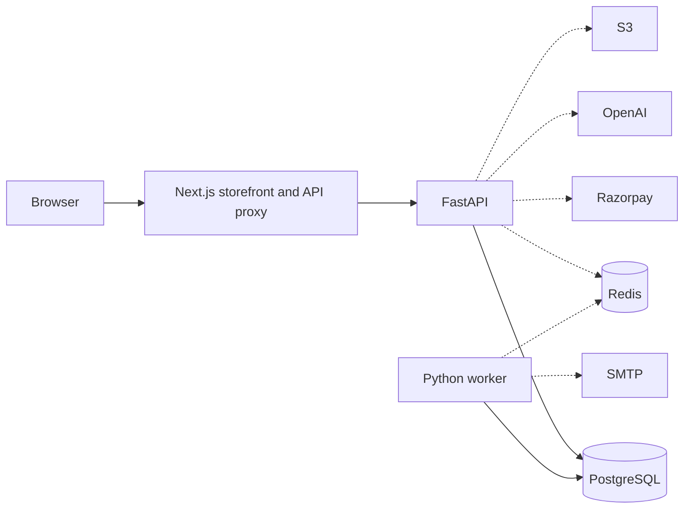
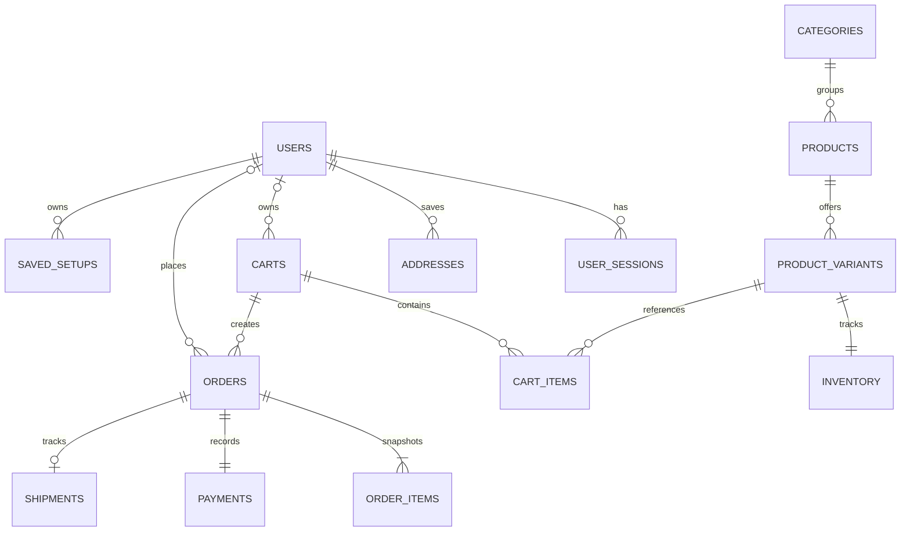
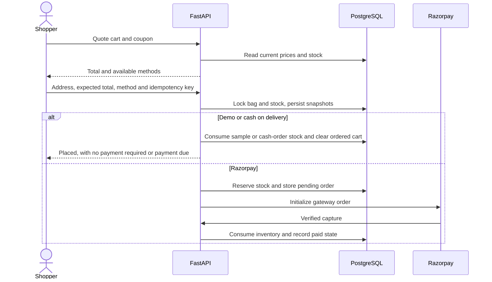
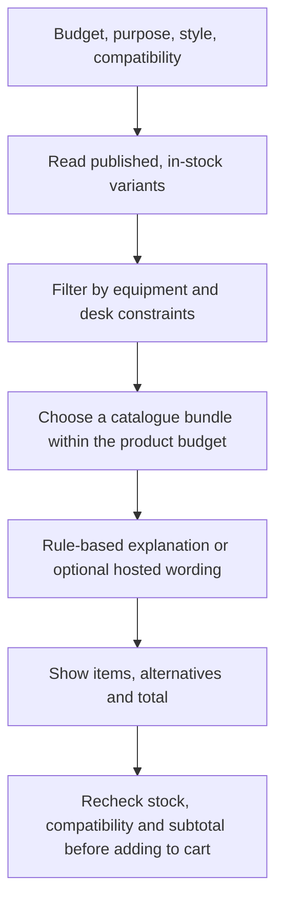

# DESKLY architecture and API

The browser runs a Next.js App Router storefront with React and TypeScript. Server components read catalogue and account data through FastAPI. Browser mutations use the Next.js same-origin proxy. FastAPI validates request bodies with Pydantic, uses SQLAlchemy with psycopg for PostgreSQL access and uses Alembic for migrations. The Python worker handles payment reconciliation and the email outbox. Redis is optional locally and required in production for shared request limits and coordination.

Public views fetch published records on the server and interactive components call `/api/v1`. The proxy forwards cookies, idempotency keys and relevant gateway headers. The API enforces browser origin, authentication, role and record ownership. Registration and login create an opaque session cookie with a stored token digest. Passwords use Argon2. Logout revokes the session. Anonymous carts belong to a guest cookie and can merge into the user's bag at sign-in.

PostgreSQL is the source of truth for prices, orders and inventory. Checkout locks the current cart and variant stock before saving order snapshots. An idempotency key is scoped to the caller. Fulfillment checks allowed transitions server-side. Demo orders affect sample inventory and remain excluded from paid revenue. Cancellation of a placed demo or cash order restores inventory.

Local setup runs the frontend, API, worker, PostgreSQL and Redis through Compose. Running without Compose can use the local in-memory limiter. Production uses a Vercel frontend with server-only `API_URL`, a separately hosted HTTPS FastAPI API and worker, PostgreSQL and Redis. Production writes require the configured `APP_ORIGIN`. [Setup and deployment](../README.md)

All paths in the table are under `/api/v1`. Requests and responses use JSON. Cart and checkout use the guest or session cookie. Authenticated routes enforce ownership or the admin role. Amounts are integer paise. The running FastAPI app serves [complete OpenAPI JSON](http://127.0.0.1:8000/openapi.json).

| Method and URL | Purpose and access | Request format | Success response | Typical errors |
| --- | --- | --- | --- | --- |
| GET `/products` | List products, public | Query `q`, `category`, `available`, `sort`, `page` | Paginated catalogue with variants and prices | 422 |
| GET `/products/{slug}` | Product details, public | Slug | Product and variant availability | 404 |
| POST `/auth/register` | Create account, public | Name, email, password and confirmation | 201 profile and session cookie | 409, 422, 429 |
| POST `/auth/login` | Sign in, public | Email and password | Profile and session cookie | 401, 422, 429 |
| POST `/auth/logout` | End session | Session cookie | Revocation response and cleared cookies | 403 for invalid origin |
| GET `/me` | Get profile, session | Session cookie | Customer or administrator profile | 401 |
| GET `/cart` | View bag, guest or session | Cookie when present | Lines, counts and subtotal | 503 |
| POST `/cart/items` | Add a line, guest or session | `variant_id` and `quantity` | Updated cart | 404, 409, 422 |
| PATCH, DELETE `/cart/items/{id}` | Change own bag | Line ID and `quantity` for PATCH | Updated cart | 404, 409, 422 |
| POST `/checkout/quote` | Price bag, guest or session | Optional `coupon` | Totals and payment availability flags | 409, 422 |
| POST `/checkout/orders` | Save order, guest or session | Address, `expected_total`, optional coupon, `payment_method`, `Idempotency-Key` header | 201 order, state and gateway fields when applicable | 409, 422, 503 |
| GET `/me/orders` | Order history, session | Optional `page` | Array of owned order summaries | 401, 422 |
| POST `/builder/recommend` | Match a setup, public | Paise budget, purpose, aesthetic and optional constraints | Items, stock-aware alternatives, totals and explanation source | 422, 429 |
| POST `/builder/add-to-cart` | Add setup, guest or session | Preferences, variant IDs and expected total | Updated cart | 409, 422 |
| POST `/admin/products` | Create product, admin | Name, slug, category ID and product fields | 201 product | 401, 403, 409, 422 |
| PATCH `/admin/products/{row_id}` | Edit product, admin | Product fields | Updated product | 401, 403, 404, 409, 422 |
| POST `/admin/inventory/adjustments` | Adjust stock, admin | Variant ID, quantity delta and reason | Updated stock | 401, 403, 404, 409, 422 |
| PATCH `/admin/orders/{row_id}/fulfillment` | Advance an order, admin | Status, carrier and tracking when shipping, cash collection when required | Updated order | 401, 403, 404, 409, 422 |

Errors include a user-facing `detail`, optional field errors and `X-Request-ID`. [Additional REST contracts](api.md) · [Deployment and verification](testing-deployment.md)
