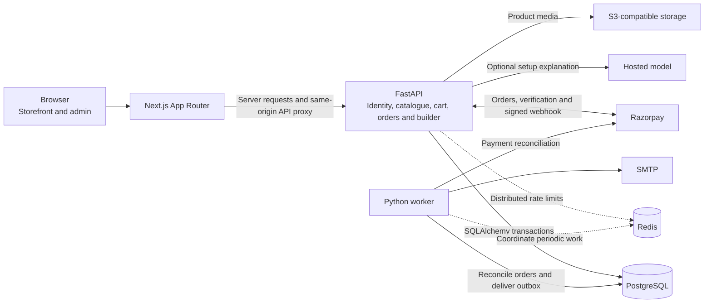
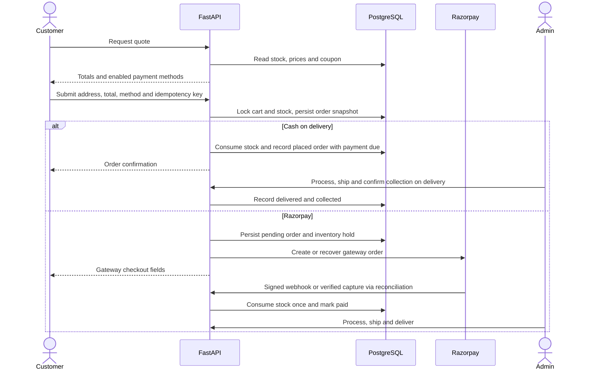

# DESKLY architecture

## System overview

Next.js renders catalogue and product pages on the server and forwards browser API requests through the same origin. The backend checks the origin for browser mutations and the caller’s role or record ownership for protected data. Argon2 protects passwords. The database stores hashes of opaque session and guest tokens. Provider credentials belong in the backend environment.

PostgreSQL owns products, stock, prices, carts, orders, payment records and the notification outbox. Redis is optional for single-process local development. The worker uses a Redis lease when configured and row locks for outbox claims.

## Checkout and fulfillment

The cart and inventory rows are locked in stable order. Snapshots preserve the product names, variants and prices at purchase time. Retrying the same body and idempotency key returns the original order. Key reuse with different details yields a conflict. Online holds expire through worker reconciliation. Late captures after a release are flagged for operator review. Cash-on-delivery cancellation before processing restores the stock and releases the coupon redemption. Paid revenue includes cash orders after collection.

## Data model

| Domain | Tables |
| --- | --- |
| Identity | users, user_sessions, password_reset_tokens, addresses |
| Catalogue | categories, products, product_variants, product_images |
| Inventory | inventory, inventory_movements, inventory_reservations |
| Shopping | carts, cart_items, wishlists, coupons, coupon_redemptions |
| Orders | orders, order_items, payments, payment_webhook_events, shipments |
| Builder | saved_setups, saved_setup_items, ai_builder_runs |
| Operations | admin_audit_logs, email_jobs, business_events |

A variant belongs to a product and has inventory. A cart has item quantities and belongs to a user or guest. An order owns item snapshots, a payment record, stock holds and optional shipment data. Unique constraints protect checkout keys and webhook event IDs. Alembic revision `0002` adds the payment method and backfills existing orders as Razorpay.

## API contracts

Requests and responses use JSON under `/api/v1` unless marked as uploads. Amounts are integer paise. The browser proxy forwards cookies and upstream request IDs. The [REST API contract guide](api.md) documents request fields, ownership, responses and failure states. The running backend publishes the [OpenAPI schema](http://127.0.0.1:8000/openapi.json).

## Recommendation pipeline

1. Validate budget, use case, required categories, equipment and optional dimensions.
2. Filter active variants by available stock and compatibility.
3. Select one item per category from a cost and utility frontier. Prioritize coverage of the requested categories.
4. Produce a deterministic explanation or request an optional structured explanation from the hosted model.
5. Validate item selection again on edit, save and add-to-bag. The backend controls products, prices and stock throughout.

Free-text notes are saved for reference. Structured controls enforce compatibility. The model receives only the sanitized selection and cannot introduce items or change prices.

[UI flows and component breakdown](design.md) · [Deployment and verification](testing-deployment.md)
